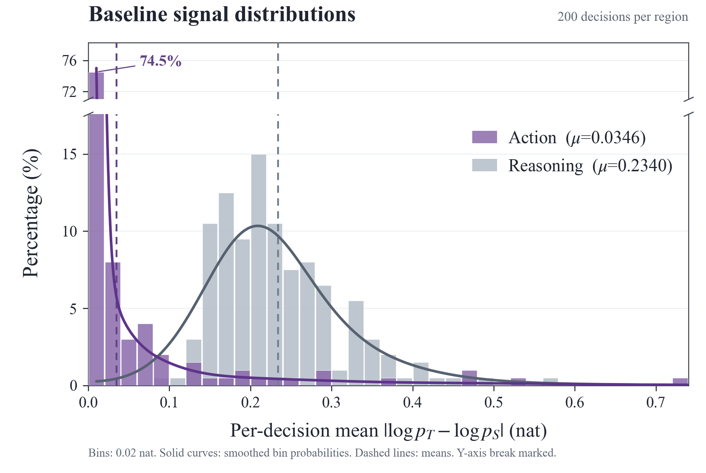

# 01 · 基线信号分布

## 实验含义

比较同一批真实环境决策中，Reasoning 正文与 Action 正文的 Teacher–Student sampled-token 评分差异。模型为 **Qwen2.5-3B GRPO+OPSD update150 基线**；Teacher 使用相同权重、额外看到静态 task-family skill，Student 没有这些特权信息。输入来自该基线自己的训练归档，不是方法模型，也不是新生成的 final150 on-policy 轨迹。

## 每条数据及计算

`data/decision_values.csv` 共 200 行，每行是一个环境决策，`id` 对应 `raw/cases.jsonl` 和 `raw/scores/<id>.json`。`reasoning`、`action` 为相应正文区域的平均绝对 gap；`reasoning_tokens`、`action_tokens` 为参与统计的 token 数。两组是 200 对值，不是 400 个独立状态。

$$
S_{i,C}=\frac{1}{|C_i|}\sum_{t\in C_i}\left|\log p_T(y_t\mid\cdot)-\log p_S(y_t\mid\cdot)\right|,\quad C\in\{R,A\}.
$$

`raw/scores/*.json` 的 `conditions.native.tokens` 保留 `token_id`、`region`、`student_logp`、`teacher_logp`、`abs_gap`。先在每个决策内求区域 token 均值，再对决策等权；不把所有 token 混为一个均值。协议标签、RETHINK 和 EOS 不计为 Action 正文。

## 图的读法

- 紫色 Action，灰色 Reasoning；x 单位 nat，y 为组内分箱百分比。
- 共用 bin 宽 0.02 nat，第一根 Action 柱 149/200=74.5%。
- 原始均值：Action 0.034637060828157686；Reasoning 0.2340344554144021。
- y 轴显示 [0,17.6] 与 [71,78.3]，断轴已标出；不删除点。
- 实线为自适应零边界反射 Gaussian KDE 的分箱概率百分比，不是额外实验数据。稳健 Silverman pilot 带宽乘 2.5，并以局部 pilot 密度调整样本带宽。不是把 PDF 直接画到百分比轴。

`data/smoothing_audit.json` 保留原平滑审计。`plot.py` 使用相同样本、分箱、均值和核平滑规则，输出 `reproduced.png` / `.svg`。

## 解释边界

这是对已采样 token 的评分差，不是完整词表／动作分布 KL，不是参数梯度，也不是动作正确率。归档文本有重分词与重构，不能称为训练 token 批次的逐位重放。此图不单独证明训练的因果瓶颈。
