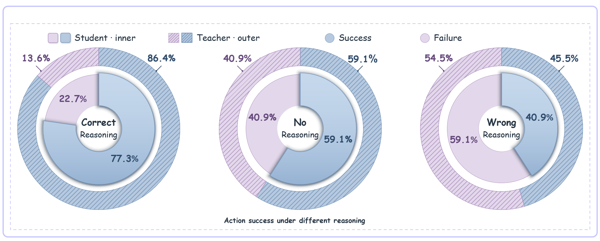

# 02 · 相同 History 下的 Reasoning 干预

## 实验问题与模型

保持环境历史 H 不变，分别给定 Teacher 正确 R、删除 R 内容、Student 错误 R，再比较下一步动作是否命中冻结参考动作集合。使用 **Qwen2.5-3B GRPO+OPSD 基线 update150**；Teacher／Student 权重相同，Teacher 额外看到静态 task-family skill，没有 Decision Analyzer 或局部 hint。

22 个配对状态来自基线真实训练归档，原始 Student R 经审核错误、Teacher 生成的 R 经审核正确。它是一个条件筛选子集，不代表任意状态或 Teacher 整体可靠率。

## 数据单位与结果

每状态 × 3 个 R 条件 × 2 个视角，共 **132 个动作续写单元**，同状态跨条件配对。

| 条件 | Teacher | Student |
| --- | ---: | ---: |
| 审核正确的 Teacher R | 19/22 = 86.4% | 17/22 = 77.3% |
| 删除正文、保留标签 | 13/22 = 59.1% | 13/22 = 59.1% |
| 审核错误的 Student R | 10/22 = 45.5% | 9/22 = 40.9% |

统一 greedy 动作续写，最多 64 tokens，在 `</action>` 停止。删除条件保留 reasoning/action 格式边界，只清空 R 正文。

## 文件与字段

- `data/counts.csv`：六格计数，`condition`、`branch`、`n`、`hits`、`non_hits`。
- `data/decision_cells.csv`：132 条观测，`id`、`condition`、`branch`、`generated_action`、`reference_hit`、`executable`、`format_valid`、`Q`。
- `raw/paired_reviewed_cases.jsonl`：22 个冻结 H、两种 R、admissible 动作、参考动作和审核记录。
- `raw/score.jsonl`：22 行、每行六格，`cells.<condition>.<branch>.free_action` 是实际生成；`actions` 保留所有候选动作分数；`correct_probability` 是参考动作集合的候选概率质量。

蓝色参考命中、紫色未命中；Teacher 外环、Student 内环。Success 在这里应解释为单步动作参考集命中，不是完整 episode 成功。参考集合并非穷举所有合理探索动作，未命中不能一律解释为确定错误。

`figures/figure.png` 是提供的原图。精确排版源码没有找到，因此附上 `plot.py` 与 `figures/reproduced.png` / `.svg`，重算数字相同，不声称逐像素还原原图。
