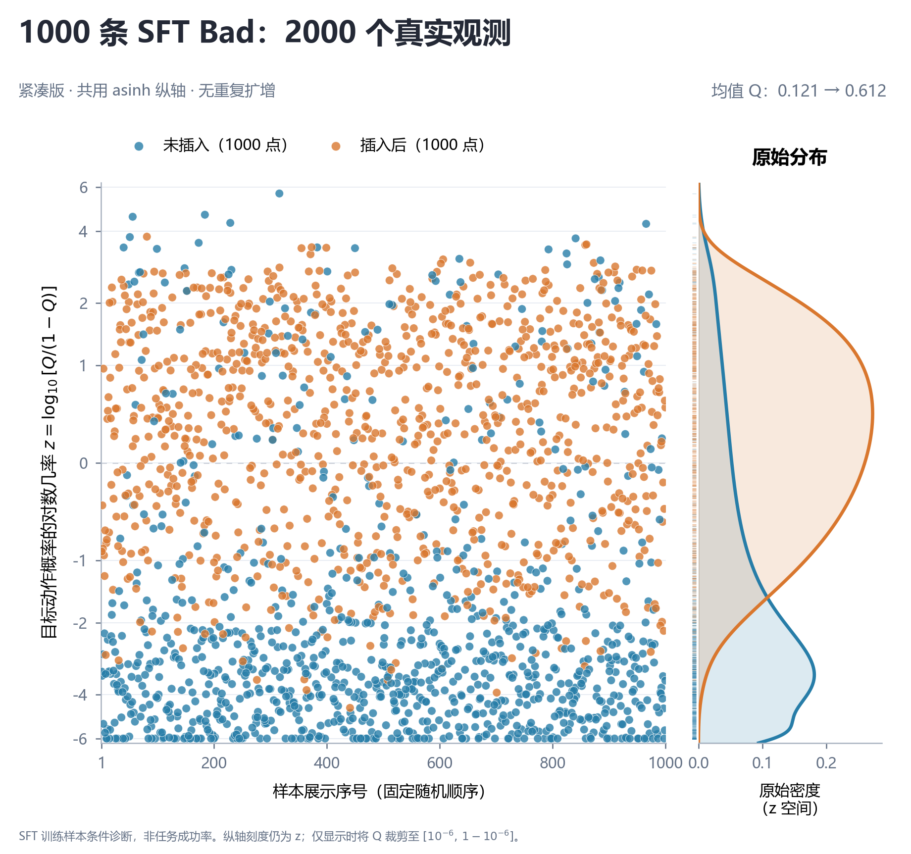

# 03 · 1000 对真实 SFT Bad 样本的 RETHINK 插入干预

## 样本与模型

从已存在的 SFT train split 中 6000 条 Bad 随机抽取 **1000 条**，sampling seed=20261103；对应 155 个任务、六种 task family。完整保留原始任务、历史 H、reasoning R、admissible 动作与单个 `oracle_action`，不重新采轨迹或重标 reasoning。

测量的是冻结 **Qwen2.5-3B Route-SFT2000 → OPSD150** 方法模型，不是基模或基线。父模型与文件 SHA 见 `raw/measurement_contract.json`。不需要 Teacher、hint、Analyzer 或 API；测量没有优化器更新。

## 配对干预及 Q 的定义

对每个原始 H/R，保持权重、候选动作、上下文、分词和评分方法不变，只比较：

- `without_marker`：R 后直接进入 action；
- `with_marker`：在相同边界插入一个注册的 `<RETHINK>`（token ID 151665），再进入 action。

上下文 H+R 按原 SFT 拼接方式一同分词，后缀单独分词，不额外清洗或截断。`prefilled_suffix_ids` 在两条件只多一个 marker：无 marker 的 action 开头为 `[27,1311,29]`，有 marker 为 `[151665,27,1311,29]`。`scoring_boundary` 相应是 3 和 4。

对候选动作 a 计算完整 action 内容及闭合标签的序列 log likelihood，不做长度归一化、不加 EOS。因为 action 开头已给定，候选间共用开头项不参与区别。对本状态记录的所有 admissible 候选做 softmax：

$$
Q(H,R,m)=\frac{\exp\ell_\theta(a^*\mid H,R,m)}{\sum_{a\in\mathcal A_{\mathrm{adm}}(H)}\exp\ell_\theta(a\mid H,R,m)}.
$$

这里 a* 是**样本存储的单个 Oracle 动作**，不是所有正确动作的穷举集合。Q 是候选集合内的相对概率，不是完整 episode 成功率。

## 结果与画法

| 指标 | 数值 |
| --- | ---: |
| 配对样本 | 1000 |
| 真实条件观测 | 2000 |
| 均值 Q，不插入 | 0.12082768806300861 |
| 均值 Q，插入后 | 0.6118690232933994 |
| Q 上升／下降／不变 | 918／82／0 |

蓝色 `#277DA8` 未插入，橙色 `#D9772E` 插入后，各 1000 点。横坐标为固定随机展示序号，不按效果排序。**没有复制点、没有把旧 100 对数据混入。**

纵轴先算 $z=\log_{10}[Q/(1-Q)]$，显示位置共同使用 asinh(z)，刻度仍显示 z。为了有限坐标，仅绘图时将 Q 裁剪至 [1e-6,1−1e-6]；90 个未插入观测落在下限，没有删除，原始 Q 保留。z=0 对应 Q=0.5；z=1 对应 Q≈0.909。

右侧是在原始 z 空间估计的 Gaussian KDE，两组共用带宽 0.6605238611291134；密度不是百分比。图尺寸 8×7.5 inch，沿用紧凑蓝橙版，所有 2000 点都参与展示。

## 文件关联与字段

- `raw/sampled_sft_bad1000.jsonl`：1000 条原始 SFT 样本，`sample_id` 为关联键；`prompt` 是 H，`assistant_prefix` 是 R，`oracle_action` 是目标。
- `raw/paired_results.jsonl`：1000 行，`id` 关联 `sample_id`；`paired` 含两臂的 `target_probability`、每个候选的 `action_scores`、前缀 token IDs 与边界；`context_token_ids` 为原始 H/R tokens。
- `data/paired_Q1000.csv`：一行一对；`Q_without`、`Q_with`、`delta_Q`、显示用 z 和展示序号。
- `data/observations_2000.csv`：一行一个条件观测，共 2000 行，不能当作 2000 个独立状态。
- `raw/sample_receipt.json`：采样种子、来源划分、任务统计、原始数据 SHA。
- `data/visualization_audit.json`、`data/compact_reference_style_audit.json`：顺序、变换、颜色及图指纹。
- `raw/GPU_scoring_parity.json`、`raw/preflight.json`：原测量的数值与边界检查记录。

`plot.py` 从原始逐条测量重新算 Q 数组，重用同一展示排列和 KDE 带宽，默认输出到 `reproduced/`。原 `paired_results.jsonl` SHA256 为 `311850a2d06778e54a9af8f1abc8d9125a0cfeb2b57f1b33d445687c198ca3de`。

## 结论范围

这是**训练样本上的条件干预诊断**，不是 held-out 泛化、自然生成触发率或路由准确率。1000 条来自 155 个任务，同任务样本可能相关。旧的 100 状态实验来自不同样本，不在本目录，也不沿用旧均值。模型原始推理需要额外权重；本仓库只保证离线从包含的原始测量核验与重画。
