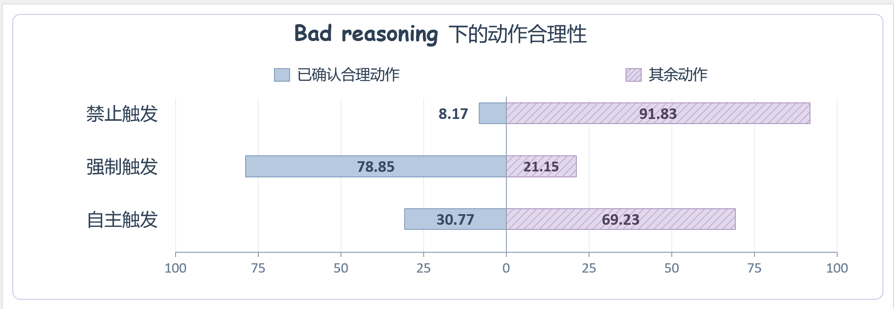

# 04 · Bad Reasoning 下三种触发模式的动作合理性

## 干预方式

同一 **Qwen2.5-3B RETHINK 方法 update150** 模型，对相同冻结 H/R 使用三种续写约束：

- `forbid` 禁止触发：将 marker token logit 设为负无穷。
- `force` 强制触发：在 R/action 决策边界预填 marker，再生成。
- `natural` 自主触发：相同 R 后无干预续写，允许模型自行选择。

Actor 不看 hint、不调用 API。给定已有 R，不是从空 assistant 前缀重新思考整条轨迹。13 个状态为混合来源的固定 Bad 面板，9 个来自 base、4 个来自 method150；三个模式使用的测量权重完全相同。

## 预算与数据单位

每状态每模式 16 次，temperature=0.4、repetition_penalty=1；统一总 response 预算 512，包括预填 R/marker；在第一个 action 闭合时停止。相同 state/repeat 使用对应随机种子，保留原生 R token IDs。

每模式 13×16=208 次，合计 624 次生成；**只有 13 个独立状态单位，不是 208 或 624 个独立状态，也不是完整 episodes。**

| 模式 | 已确认合理 | 已确认不合理 | 未判定 | 已确认合理比例 |
| --- | ---: | ---: | ---: | ---: |
| 禁止触发 | 17 | 143 | 48 | 8.17% |
| 强制触发 | 164 | 1 | 43 | 78.85% |
| 自主触发 | 64 | 68 | 76 | 30.77% |

蓝色表示已确认合理动作，紫色斜线表示其余=已确认不合理+unknown；**不能将其余全解释为错误**。百分比来自 known-positive 下界口径。左右方向仅用于排版，负向坐标不是负概率。

## 数据与核验

- `raw/jobs/*.json`：624 个原始生成输出，包括 mode/repeat、生成文本、token IDs、seed、action 和最初 value。
- `raw/panel_original.jsonl`：13 个原始状态。
- `raw/review_addendum_v2.json`、`review_addendum_v3.json`：既有审核修订，不是本次新标注。
- `raw/panel_final_adjudication.jsonl`：应用历史修订后的最终裁决，按 `decision_id` 关联 jobs。
- `data/derived_generations.csv`：624 条记录，保留原始 `raw_record_value` 和最终 `final_value`，不覆盖旧原始判定。
- `data/state_metrics.csv`：39 行状态×模式；`data/counts.csv` 汇总三模式。

`verify_data.py` 按最终冻结 action 目录重算 known-positive/zero/unknown，且核对每状态每模式确有 16 个 repeat。失败或证据不足保留 unknown，非 admissible action 记 zero。

`figures/figure.png` 为提供的原图；精确原排版源码未找到，`plot.py` 和 `figures/reproduced.*` 提供相同数字的重绘版。此图不直接给出自然路由 precision/recall，也不代表完整任务成功率。
