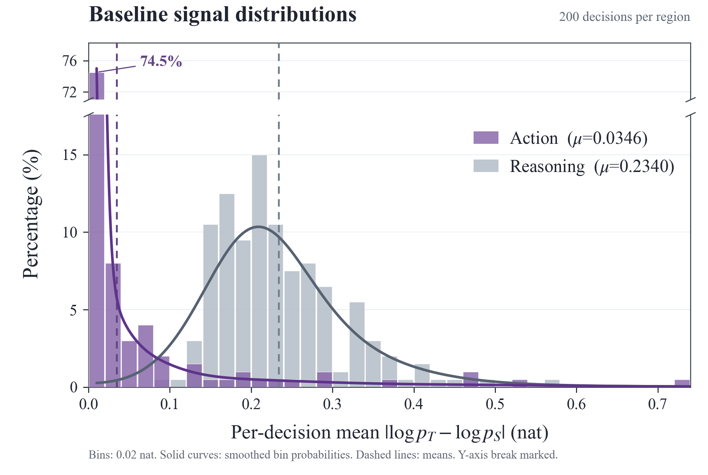
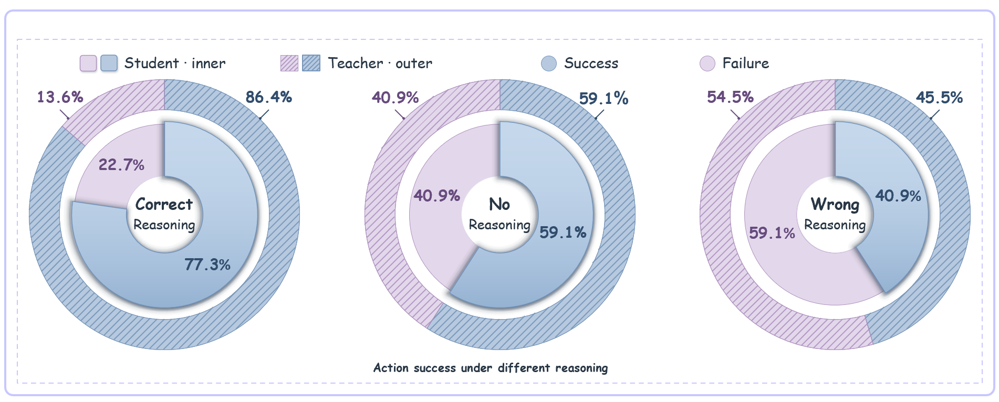
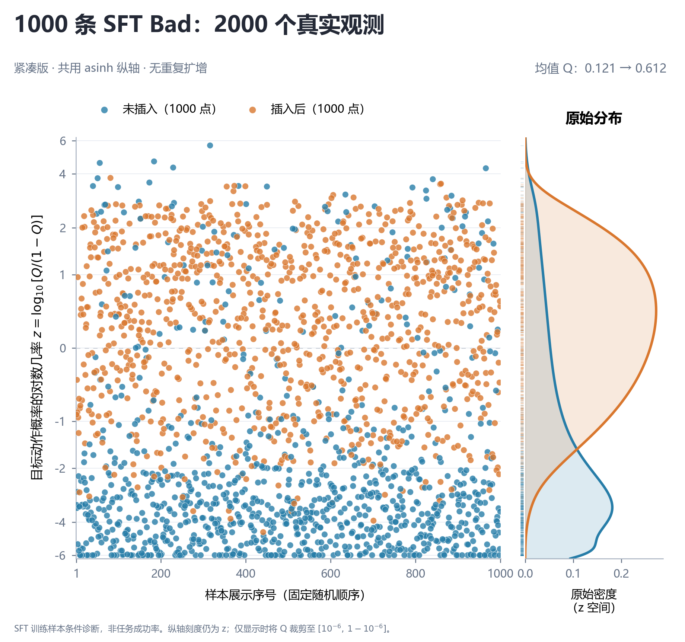
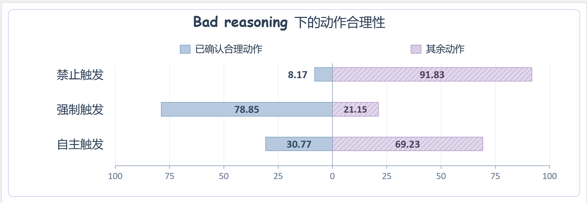

# RETHINK：四项分析实验的图、原始数据与脚本

本仓库按四个实验分目录，收录现有图、逐决策／逐 token 原始测量、数据表、指标定义和离线重绘脚本。

## 四项实验一览

| 文件夹 | 要回答的问题 | 主要结果 |
| --- | --- | --- |
| [01：基线信号分布](01_baseline_signal_distribution/) | 基线中 Reasoning 和 Action 的 sampled-token Teacher–Student 差异有多大？ | Action 均值 0.0346 nat；Reasoning 0.2340 nat |
| [02：Reasoning 条件干预](02_reasoning_intervention/) | 在相同历史下，正确／删除／错误 Reasoning 怎样影响下一步动作？ | 正确 R：19/22、17/22；删除 R：13/22、13/22；错误 R：10/22、9/22 |
| [03：RETHINK 插入干预](03_rethink_insertion/) | 固定 H/R，只插入一个 marker，后续动作的正确概率如何变化？ | 正确动作平均概率 Q：0.1208 → 0.6119 |
| [04：三种触发模式](04_bad_reasoning_action_quality/) | 禁止／强制／自主触发rethink标记时，生成正确动作的比例怎样变化？ | 禁止：17/208、强制：164/208、自主：64/208|

## 01 · 基线 Reasoning / Action 信号分布



横轴为每个决策内部的平均绝对 Teacher–Student sampled-token log-probability gap，纵轴为分箱百分比。紫色是 Action，灰色是 Reasoning；虚线是均值，实线是平滑后的分箱概率，y 轴断开处已标出。200 个决策中，149 个 Action 区域均值落在 [0, 0.02) nat。

使用 Qwen2.5-3B GRPO+OPSD 基线 update150，对其自身训练归档决策重新评分；Teacher 与 Student 权重相同，Teacher 额外看到静态 task-family skill。归档文本存在重新分词，不能当作原训练 token 批次的逐位重放。

## 02 · 相同 History 下改变 Reasoning



外环 Teacher、内环 Student；蓝色表示下一步动作命中冻结参考集合，紫色表示未命中。两者使用同一基线 update150 权重，区别仅在 Teacher 的静态 skill。三列分别给定已审核正确的 Teacher R、清空正文但保留标签的 R、已审核错误的 Student R。

22 个状态是“Student R 错误且 Teacher R 审核正确”的条件子集。图上 Success 应读为**下一步动作参考集命中**，不是 episode success；未命中不自动等于所有语义口径下都错误。

## 03 · 真实 1000 对样本的插入／不插入散点



从既有 SFT train split 的 6000 条 Bad 中用 seed=20261103 随机抽 1000 条，保留原始 H/R。冻结的方法模型为 Qwen2.5-3B Route-SFT2000 → OPSD150；两个条件只差 reasoning/action 边界处一个注册的 `<RETHINK>` token。不使用 Teacher、hint、Analyzer 或 API。

蓝色是不插入，橙色是插入后，各 1000 个真实观测。Q 是数据中单个 Oracle 动作的完整动作序列似然在记录的 admissible 动作集合内归一化后的概率；它不是完整任务成功率，也不是所有合理动作的概率之和。

纵轴为 $z=\log_{10}[Q/(1-Q)]$，显示位置共同使用反双曲正弦变换 `asinh(z)`，刻度仍标原始 z；仅显示时把 Q 裁剪到 $[10^{-6},1-10^{-6}]$，原始 Q 不变。横轴是固定随机展示顺序。右侧是在原始 z 空间、共用带宽的 KDE，不含重复扩增。

这是 **SFT 训练样本上的条件诊断**，不是 held-out 泛化、自由生成路由率或自然触发效果评测。其采样来源和旧 100 状态实验不同，不混用旧均值 0.311 → 0.738。

## 04 · Bad Reasoning 下的动作合理性



同一方法 update150 权重，在固定 R 后分别禁止 marker、预填 marker、无干预自主续写。蓝色为已确认合理，斜线紫色是其余，**包括已确认不合理与 unknown，不能全叫错误**。13 个状态每个各模式采样 16 次，temperature=0.4；并不是 208 个独立环境状态。

## 仓库内有什么

每个实验目录均含 `README.md`、`figures/`、`data/`、`raw/` 和 `plot.py`。`data/` 是直接用于画图的数据表，`raw/` 保留用于重算这些表的逐条原始测量与冻结输入／审核记录。原始科学内容按字节保留，`artifact_manifest.json` 记录逐文件来源指纹，不含私人操作路径。

图②、图④的展示图保留已提供的原图；对应 `figures/reproduced.png` / `.svg` 和 `plot.py` 是**相同数据的重绘版**，不声称恢复原图的精确排版源码。图①、图③附有原始 PNG/SVG；重绘可能因系统字体产生少量排版差异。所有重绘默认另存，不覆盖原图和数据。

## 独立离线运行

只需要 **Python 3.11+、requirements.txt 里的 NumPy / Matplotlib，以及一个中文字体**。Python 3.13.11 是已用的验证版本。不需要 GPU、模型权重、API key、原工作区或原服务器。

```bash
python -m venv .venv
# Linux/macOS:
source .venv/bin/activate
# Windows PowerShell 使用：.\.venv\Scripts\Activate.ps1
python -m pip install -r requirements.txt
python verify_data.py
python plot_all.py
```

Linux 若没有中文字体，先安装系统字体包（Debian/Ubuntu 示例）：

```bash
sudo apt-get update
sudo apt-get install -y fonts-noto-cjk
```

Windows 可使用已有的 Microsoft YaHei / SimHei；Linux 优先 Noto Sans CJK SC。字体是明确的系统依赖，没有分发商业字体文件。预生成 PNG 和 SVG 可直接查看，无需安装任何东西。

单独重绘某项：

```bash
python 03_rethink_insertion/plot.py --output-dir reproduced/03_rethink_insertion
```

`verify_data.py` 仅使用 Python 标准库，逐文件校验 `SHA256SUMS.txt`，从原始记录重算四项数字、配对关系、候选概率和监督边界。`plot_all.py` 离线重绘四项到 `reproduced/`。

实际的干净检出、全新虚拟环境安装与四项重绘结果见 [离线复现验证记录](REPRODUCTION.md)。

**复现范围：**这里验证的是“仓库内原始测量 → 数值核验 → 图”。不包含模型权重，不声称仅凭本仓库可重新执行原始 GPU 训练／推理实验。ALFWorld 环境观察、动作、静态 skill 和记录的审核属于本次分析数据；没有上传账号、SSH、API 密钥、机器配置或无关训练日志。

许可未另行指定；本次先按私有研究资料整理，公开和再分发前请核对原始数据与上游资产的适用许可。
